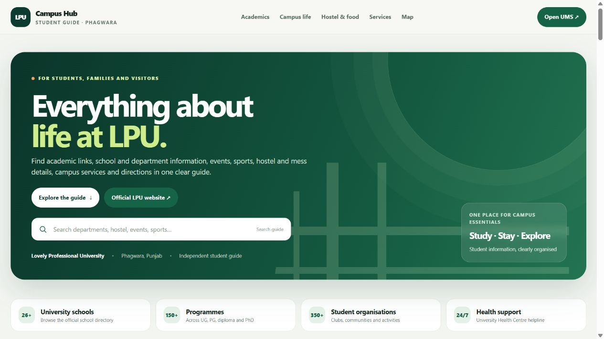

# LPU Campus Hub

A mobile-friendly, installable student guide for Lovely Professional University. It brings academic links, the official school directory, events, sports, hostel and mess information, student services and campus directions into one place.

**Independent student project:** this is not an official LPU application and does not connect to private student accounts. Official university links are included for current notices, account-only information and details that may change.

## What is included

- Searchable directory covering 27 LPU schools and academic areas
- Admissions, programme, scholarship, calendar, library, placement and UMS links
- Campus event, student organisation, arts and culture information
- Sports and fitness overview with official team and facility links
- 2026–27 hostel room and mess fee summaries, meal times and sample menu notes
- Health centre, security, transport, dining, banking and communications links
- Google Maps route planner, address and a virtual campus tour
- Progressive Web App setup for installation and basic offline access after the first visit

## Publish or preview

This is a static site: it has no build step and can be deployed by uploading the contents of this folder to Netlify or GitHub Pages. Open `index.html` directly for a quick preview. The install prompt and offline cache require HTTPS hosting (for example, Netlify or GitHub Pages).

## Source and update policy

Core facts were checked against public LPU pages on 2 November 2026. The site links directly to official sources because event schedules, programme criteria, fees, room availability and service details can change. Confirm them with LPU before making decisions.
